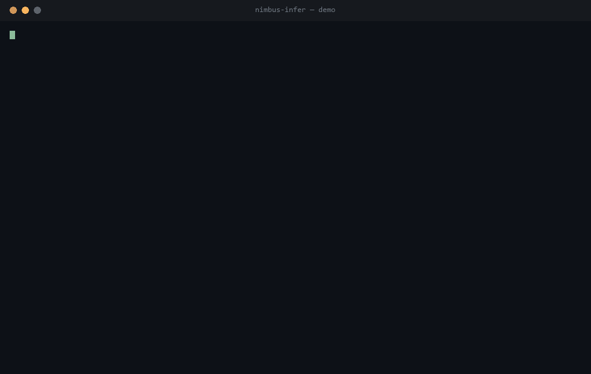
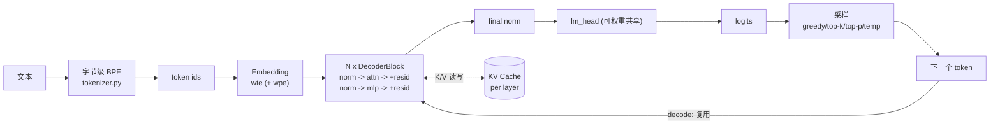

# NimbusInfer

[](https://github.com/WuxieLUK/nimbus-infer/actions/workflows/ci.yml)
[](https://python.org/)
[](https://numpy.org/)
[](LICENSE)

**NimbusInfer** 是一个从零实现的大模型推理引擎。分词、注意力、KV Cache、采样、权重解析、量化全部手写，**唯一依赖是 NumPy**——不调用 PyTorch、Transformers、safetensors、tokenizers 中的任何一行代码。

目标是证明：一个大模型推理引擎的每个环节都可以被清晰地构建、测试和讲解，而不是被一行 `model.generate()` 隐藏在框架里。

> A from-scratch, NumPy-only LLM inference engine: byte-level BPE, prefill/decode with a KV cache, GPT-2 **and** LLaMA architectures, hand-rolled safetensors parsing and int8/int4 quantization.



*（GIF 由 `docs/make_demo_gif.py` 用真实命令输出渲染而成，不是录屏；演示权重是随机初始化的，所以生成文本是乱码——引擎本身是对的。）*

## 为什么是它

你的仓库已经有应用层的 AI 项目（RAG、智能体、面试陪练、学习助手），也有 `nimbus-vm` / `nimbus-git` / `nimbus-kv` 这些系统底座。这个仓库补齐的是 **AI 基础设施 / 推理系统** 这一类最容易被追问、也最能体现硬实力的方向：不是"调用"大模型，而是"造"大模型的运行时。

## 功能特性

- **字节级 BPE 分词器**：支持从零**训练**词表，也支持加载 HuggingFace 格式的 `vocab.json` + `merges.txt`；纯字节级，任何输入都能无损往返，无需 `<unk>`。
- **两代架构，一套代码**：GPT-2（LayerNorm + GELU + 学习式位置编码 + MHA）与 LLaMA（RMSNorm + SwiGLU + RoPE + GQA）由同一份 `forward` 驱动。
- **KV Cache**：prefill / decode 两阶段，解码时单 token 前向、复用历史 K/V；缓存与全量重算在测试中被证明数值一致。
- **完整采样栈**：greedy、temperature、top-k、top-p（nucleus）、repetition penalty、可复现种子。
- **流式生成**：逐 token 增量解码，UTF-8 安全（不会吐出半个多字节字符）。
- **手写 safetensors**：自己解析 `<uint64 头长度><JSON 头><原始缓冲>`，支持 bfloat16 展宽；也可写回用于测试。
- **HuggingFace 权重映射**：把 `q_proj / k_proj / v_proj`、`c_attn` 等命名映射到本引擎参数（含 `(out,in) -> (in,out)` 转置与合并 QKV 的拆分）。
- **int8 / int4 量化**：对称 round-to-nearest，按输出通道或按分组；**4-bit 真正按半字节打包**，体积约为 int8 的一半。
- **基准工具**：一键测出 KV Cache 相对全量重算的加速比、每 token 缓存开销、量化压缩率。
- **浏览器可视化 Demo**：只依赖标准库 `http.server`，SSE 逐 token 流式输出 + 实时 tok/s / 缓存占用面板 + 采样参数滑块 + **注意力热力图**。零前端构建。
- **终端交互式 REPL**：`chat` 命令，多轮对话共享同一份 KV Cache——后续轮只 prefill 新输入，缓存持续增长。
- **接入真实权重**：`convert` 命令用标准库 `urllib` 下载 HuggingFace checkpoint 并转成本引擎格式，让输出从乱码变成真英文。
- **CLI**：`generate` / `tokenize` / `inspect` / `bench` / `convert` / `chat` / `serve`。

## 快速开始

要求 Python 3.10+，唯一依赖是 NumPy。

```bash
pip install -r requirements.txt

# 一条命令跑通全流程：训练分词器 -> 建模型 -> 存盘 -> 重载 -> 生成 -> 基准 -> 量化
python demo.py
```

用 CLI 操作一个 checkpoint：

```bash
# 模型元信息（参数量、架构、KV Cache 占用）
python -m nimbus_infer inspect --model checkpoints/demo-gpt2

# 生成（贪心 / 采样 / 流式）
python -m nimbus_infer generate --model checkpoints/demo-gpt2 --prompt "the engine" \
    --max-new-tokens 64 --temperature 0.8 --top-p 0.9 --seed 7 --stream

# 查看分词结果
python -m nimbus_infer tokenize --tokenizer checkpoints/demo-gpt2/tokenizer \
    --text "the engine caches keys and values"

# 测吞吐与 KV Cache 加速比
python -m nimbus_infer bench --model checkpoints/demo-gpt2 --tokens 64
```

在代码里用：

```python
from nimbus_infer import BPETokenizer, Engine, ModelConfig, SamplingParams

tokenizer = BPETokenizer.train(open("corpus.txt").read(), vocab_size=8192)
config = ModelConfig(name="my-model", vocab_size=tokenizer.vocab_size,
                     n_layers=6, n_heads=6, d_model=384, d_mlp=1536, max_seq_len=512)
engine = Engine.random(config, tokenizer=tokenizer)          # 随机初始化
engine.save_pretrained("checkpoints/my-model")               # 写入 safetensors

engine = Engine.from_pretrained("checkpoints/my-model")      # 重新加载
print(engine.generate("The quick brown fox",
                      SamplingParams(max_new_tokens=32, temperature=0.0)))
```


## 支持的架构

| 组成 | GPT-2 家族 | LLaMA 家族 |
|---|---|---|
| 归一化 | LayerNorm (weight+bias) | RMSNorm (weight) |
| 激活 / MLP | tanh-GELU, 2 层 | SwiGLU, 3 层 |
| 位置编码 | 学习式 `wpe` | RoPE (rotary) |
| 注意力 | MHA | GQA（`n_kv_heads` 可配） |

## 架构



一次推理分成两个阶段：

- **prefill**：整个 prompt 一次前向，把每层的 K/V 写进 cache。
- **decode**：每次只喂一个新 token，复用 cache 里的历史 K/V，因此每步是 O(N) 而不是 O(N²)。

## 目录结构

```
nimbus-infer/
├── nimbus_infer/
│   ├── config.py     # ModelConfig：两代架构的统一描述 + 参数量核算
│   ├── backend.py    # NumPy 数值原语：softmax / gelu / silu / norm / mask
│   ├── tokenizer.py  # 字节级 BPE：训练 + HF 格式读写
│   ├── model.py      # 解码器：RoPE / GQA / SwiGLU / 因果注意力
│   ├── cache.py      # KV Cache（预分配、就地写入、内存核算）
│   ├── sampling.py   # 采样策略（纯函数，可单测）
│   ├── weights.py    # 手写 safetensors 读写 + HF 权重映射
│   ├── quant.py      # int8/int4 量化 + 半字节打包
│   ├── engine.py     # prefill/decode 生成循环 + checkpoint I/O
│   ├── hf.py         # 标准库下载 HF 权重 + config 映射 + convert
│   ├── server.py     # 浏览器可视化 Demo（SSE 流式 + 注意力热力图）
│   ├── chat.py       # 终端交互式 REPL（跨轮复用 KV Cache）
│   ├── bench.py      # 吞吐 / 加速比 / 缓存内存
│   └── cli.py        # 命令行入口
├── tests/            # 82 个单元测试（含 HTTP 服务集成测试）
├── benchmarks/bench.py
├── demo.py
├── docs/design.md
└── docs/competition.md
```

## 测试

```bash
python -m unittest discover -s tests -t . -v
```

覆盖范围包括：分词器往返与存盘、softmax/GELU/LayerNorm 数值、注意力因果性、**KV Cache 与全量重算数值一致性**、采样策略边界、量化误差上界与 int4 半字节打包、safetensors 读写与 bfloat16、HF 权重转置与 QKV 拆分、checkpoint 存取与流式生成一致性、**注意力捕获**、**HF checkpoint 离线转换端到端**、以及**真实启动 HTTP 服务并请求 `/api/stream`、`/api/attention` 的集成测试**。CI 在 Ubuntu 与 Windows 上跑 Python 3.10 / 3.12 / 3.13。

## 性能基准

`python benchmarks/bench.py --preset tiny --tokens 24`（CPU，NumPy）：

```
  with KV cache              ~1700 tok/s (0.015s)
  full recompute              ~340 tok/s (0.070s)
  cache speedup               ~4.8x
  KV bytes / token            4096
  int8 compression            3.88x
  int4 compression            7.53x
```

（数值随机器变化；加速比随序列变长而增大——这正是 KV Cache 存在的意义。）

## 与同类项目对比

| 项目 | 语言 | 分词器训练 | KV Cache | 采样栈 | 架构 | 量化 | 依赖 |
|---|---|---|---|---|---|---|---|
| [picoGPT](https://github.com/jaymody/picoGPT) | NumPy | ✗（直接用 GPT-2 词表） | ✗ | 仅 greedy | GPT-2 | ✗ | NumPy |
| [nanoGPT](https://github.com/karpathy/nanoGPT) | PyTorch | ✗ | ✓ | ✓ | GPT-2 | ✗ | torch |
| [llama.cpp](https://github.com/ggerganov/llama.cpp) | C++ | ✗ | ✓ | ✓ | LLaMA | GGUF | 无 |
| **nimbus-infer** | **NumPy** | **✓** | **✓** | **✓** | **GPT-2 + LLaMA** | **int8/int4** | **NumPy** |

## 竞赛答辩定位

- **技术深度**：手写因果注意力、RoPE、GQA、SwiGLU、KV Cache、字节级 BPE、safetensors 二进制解析、nibble 量化——没有一行来自现成框架。
- **正确性可证**：KV Cache 与全量重算的一致性、注意力因果性、量化误差上界都有单测固化。
- **工程完整**：CLI、checkpoint I/O、基准工具、CI 跨平台。
- **可扩展**：`ModelConfig` 用标志位描述架构，接入新变体（如 MoE、滑动窗口注意力）无需改动引擎主干。

详见 [docs/design.md](docs/design.md) 与 [docs/competition.md](docs/competition.md)。

## License

[MIT](LICENSE)
